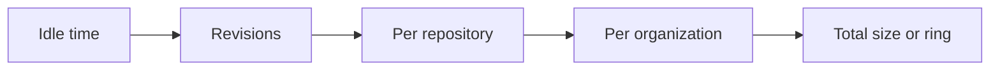

# Cache strategies

When the cache is full, something has to leave. hfproxy lets you choose what, with five eviction strategies, a set of limits, and an admission policy that decides whether a file enters at all. All of it is under **Settings → Cache rules** and applies at once, without a restart.

With the default settings nothing changes from earlier releases: every file is stored, and the least recently used files leave when `CACHE_MAX_TOTAL_SIZE` is exceeded.

Pinned files and repositories published on the proxy are never removed, whatever the settings.

## Which settings to choose

| Your situation | Strategy | Admission |
| --- | --- | --- |
| Not sure | `gdsf` | `always` |
| You want the behavior of earlier releases, or a small team using a few models | `lru` | `always` |
| Some sources are much slower than others for reasons other than file size | `cost_lru` | `always` |
| The cache is much smaller than what is requested, and people try many models once | `gdsf` | `second_request` |
| A buffer for CI or evaluation: each model serves a few days | `fifo` | `always` |

[A simulation](#what-a-simulation-says) backs the first and fourth rows, on synthetic traffic.

## One cache, five verdicts

The cache below is over its limit by 2 GiB. No file is pinned. Every strategy sees the same figures.

| File | Size | Last download | Downloads | Fetch from the Hub | Cached for |
| --- | --- | --- | --- | --- | --- |
| `llama-3-70B/model-00007.safetensors` | 4.9 GiB | 9 days ago | 1 | 8 min | 9 days |
| `bert-base/config.json` | 2 KiB | 11 days ago | 40 | 0.3 s | 60 days |
| `qwen-2.5-7B/model-00002.safetensors` | 3.8 GiB | 2 hours ago | 6 | 1 min | 3 days |
| `whisper-large/tokenizer.json` | 2.2 MiB | 6 days ago | 2 | 1 s | 45 days |
| `mistral-7B/model-00001.safetensors` | 9.6 GiB | 4 days ago | 3 | 31 min | 20 days |

The order in which each strategy lets them go, first to leave on the left. Each one stops as soon as 2 GiB are freed, shown in bold.

| Strategy | Order | Removed in the end |
| --- | --- | --- |
| `lru` | config, **llama**, whisper, mistral, qwen | config, llama |
| `cost_lru` | config, whisper, **llama**, mistral, qwen | config, whisper, llama |
| `gdsf` | **llama**, qwen, mistral, whisper, config | llama |
| `lfu` | **llama**, whisper, mistral, qwen, config | llama |
| `fifo` | config, whisper, **mistral**, llama, qwen | config, whisper, mistral |

What to read from this: `fifo` drops the file that took 31 minutes to fetch, because it came in early. `lru` drops a config file downloaded forty times. `gdsf` and `lfu` keep it and free the room with one file. They disagree later on: `gdsf` would drop the recent `qwen` shard before `mistral`, because `mistral` costs far more to bring back, while `lfu` ignores cost and drops `mistral` first.

## The strategies

### Least recently used (`lru`)

Every access moves the file to the front of one queue; the file at the back leaves. Simple and predictable, and what hfproxy always did. Its weakness: someone trying a model once pushes out files that are used every week. No settings of its own.

### LRU weighted by cost (`cost_lru`)

LRU, except that how long a file has been idle is weighed against how long it would take to fetch again:

    score = weight × ln(cost) − ln(idle time)      the lowest score leaves first

At `weight` 1, a file twice as slow to fetch may stay idle twice as long. At the default 0.5, a file four times as slow may stay idle twice as long. A high weight keeps large files for a very long time, so raise it with care.

The cost is the measured duration of the file's last fetch, in seconds. A file whose fetch was not timed (cached before this version, resumed, or found already stored under another name) is estimated from its size:

    cost = size / estimated bandwidth + estimated latency

| Setting | Variable | Default |
| --- | --- | --- |
| Cost weight, 0.1 to 2 | `CACHE_COST_WEIGHT` | `0.5` |
| Estimated Hub bandwidth, bytes per second | `CACHE_COST_BANDWIDTH` | `52428800` |
| Estimated latency, seconds | `CACHE_COST_LATENCY_SECONDS` | `1` |

A measured fetch includes the time a slow client took to read a streamed file, so cost is what the waiting client experienced, not a measurement of the Hub alone.

### Value per byte (`gdsf`)

GreedyDual-Size-Frequency, the policy Squid and CDN caches offer. A file is worth what it saves for the room it takes:

    score = ln(frequency) + ln(cost) − ln(size)      the lowest score leaves first

Frequency is the faded count described under `lfu`, and cost is the same as for `cost_lru`. Small files that are often downloaded are the best protected. When the Hub's speed is the same for everything, cost grows with size and the two cancel out for large files, which are then ranked by frequency alone. It uses the half-life and the two estimates above.

### Least frequently used (`lfu`)

Every download adds one to a counter, and the counter halves at every half-life, so a file popular in January does not stay in June. The lowest counter leaves first. Size and cost are ignored.

| Setting | Variable | Default |
| --- | --- | --- |
| Frequency half-life, hours | `CACHE_FREQUENCY_HALF_LIFE_HOURS` | `168` |

Only downloads count. The `HEAD` that `huggingface_hub` sends before each load, even of a file it already holds, keeps the file recent but does not raise its count. Downloads of one file within a minute count once, so one client's burst of requests is one use. Files cached before this version start at a count of 1, so `lfu` and `gdsf` need a few days of traffic to tell files apart; until then ties go to the least recently used.

### First in, first out (`fifo`)

A ring (pinned files count towards its file limit and are never removed, so a ring smaller than what is pinned empties everything else at each pass): files leave in the order they came in, whether they were read again or not. The cache turns over at a steady pace and nothing sticks. It suits a buffer where each model serves a few days and never again. A file read every day is still fetched again at every turn.

| Setting | Variable | Default |
| --- | --- | --- |
| Ring size, bytes (`0` = the total limit) | `CACHE_FIFO_RING_SIZE` | `0` |
| Files in the ring (`0` = no limit) | `CACHE_FIFO_RING_FILES` | `0` |

The first bound reached applies, and the total limit still holds. Other strategies ignore both.

## Limits

Each limit works on its own and applies to every strategy; `0` turns it off.

| Limit | Variable | Default |
| --- | --- | --- |
| Total size, bytes | `CACHE_MAX_TOTAL_SIZE` | `0` |
| Per repository, bytes | `CACHE_MAX_REPOSITORY_SIZE` | `0` |
| Per user or organization, bytes | `CACHE_MAX_NAMESPACE_SIZE` | `0` |
| Revisions kept per repository | `CACHE_MAX_REVISIONS` | `0` |
| Maximum idle time, hours | `CACHE_MAX_IDLE_HOURS` | `0` |
| Target after eviction, % of the limit | `CACHE_EVICTION_TARGET_PERCENT` | `90` |

A limit is checked every ten minutes and as soon as a setting changes, so the cache can go over it between two passes. A pass applies them in this order:

Here is one pass, with a 2 TiB total limit, 300 GiB per repository, 2 revisions, 30 days of idle time, and 2.3 TiB in the cache:

1. **Idle time.** Three files of `old-org/legacy-bert` were not requested for 41 days. They leave, however much room is left.
2. **Revisions.** `meta-llama/Llama-3-8B` has four commits cached. The two most recently used stay. A file an old commit shares with a newer one keeps its data and only loses its entry for the old commit.
3. **Per repository.** `deepseek/V3` holds 640 GiB. Its files leave in the order of the strategy until it holds 270 GiB, 90% of its limit. Other repositories are not touched.
4. **Per organization.** No limit set, so nothing happens.
5. **Total size.** The cache is now under 2 TiB, so nothing more leaves. Otherwise files of all repositories would leave down to 1.8 TiB.

A file shared by two commits counts once in the size of a repository.

## Admission

Eviction chooses what leaves. Admission chooses what enters, and for files of very different sizes it matters at least as much. Storing a 60 GiB model that one person tries once evicts 60 GiB of files others still use, and costs an upload to object storage for nothing.

A file that is not admitted is still served: it is streamed from the Hub, checked against its SHA-256 when the Hub gives one, and not kept. `X-Cache` says `MISS`, as for any file not served from the cache.

| Policy | `CACHE_ADMISSION` | What it does |
| --- | --- | --- |
| Store every file | `always` | The default. A file is stored the first time it is asked for. |
| Store on the second request | `second_request` | The first request streams; the file is stored when it is asked for again within the window. |
| Store if asked for more than the file it would replace | `frequency` | While the cache has room, everything is stored. When it is full, a new file must have been requested more often in the window, this request included, than the next file to leave has been used. |

| Setting | Variable | Default |
| --- | --- | --- |
| Requests are remembered for, hours | `CACHE_ADMISSION_WINDOW_HOURS` | `168` |
| Always store files under, bytes | `CACHE_ADMISSION_MIN_SIZE` | `67108864` |

Preloads are always stored: an administrator asked for the file. Files under the minimum size too, because a config file is not worth a second fetch.

**When it helps.** On a shared proxy where people try models and the cache is small compared to what they request, most of what is fetched once is never fetched again. Those files stop taking room and stop evicting the rest.

**When it does not.** If the cache is large, or most files are used more than once, `second_request` only adds a fetch from the Hub for each of them, and the second user waits for a download that `always` would have spared. On an air-gapped site, or when the Hub may be unreachable later, a file that was not stored cannot be served: keep `always`, or preload what you need. `frequency` does nothing without `CACHE_MAX_TOTAL_SIZE`.

Requests are counted from the download log, so `RETENTION_DOWNLOADS` must be longer than the window. Migration 18 adds an index on that table for these lookups; it is not built `CONCURRENTLY`, so on a very large `downloads` table writes wait while it builds (run `hfproxy migrate up` in a quiet moment). A client downloading with `Range` requests never fills the cache in any case, and these requests are not counted.

## Watching it

- `hfproxy_cache_evictions_total{reason}`: files evicted, by the limit that caused it (`idle`, `revisions`, `repository`, `namespace`, `ring`, `total`).
- `hfproxy_cache_admissions_total{result}`: misses `admitted` or `refused`.
- `hfproxy_cache_requests_total`: the hit ratio, which is the number to compare before and after a change.

Change one thing at a time and compare over a week or two, because a cache takes that long to settle.

## How these were chosen

Eviction algorithms from the research literature mostly target caches in memory with millions of small objects, where the cost of each access decides the design. hfproxy keeps a few thousand files of up to hundreds of GiB in PostgreSQL and evicts in batches, so a full sort of the catalog at each pass is affordable, and what matters is the size of files and the time to bring them back.

| Family | Examples | Here |
| --- | --- | --- |
| Recency and frequency | LRU, FIFO, LFU with aging | Implemented. The fading counter plays the role of LFU-DA's aging without shared state between replicas. |
| Size and cost | GreedyDual-Size, [GDSF](https://www.squid-cache.org/Doc/config/cache_replacement_policy/) | Implemented as `gdsf`. `cost_lru` is the same idea applied to LRU. |
| Admission | [AdaptSize](https://www.usenix.org/conference/nsdi17/technical-sessions/presentation/berger), TinyLFU, cache-on-second-hit | Implemented as `second_request` and `frequency`. |
| Fast FIFO variants | S3-FIFO, SIEVE | Not implemented. Their gain is cheap hits under concurrency, which does not apply. Their other gain, keeping one-hit files out, comes from admission here. |
| Hit density | LHD | Not implemented. It needs age histograms; `gdsf` is the practical approximation at this scale. |
| Learned | LRB, GL-Cache | Not implemented. They need far more requests than a proxy like this sees, and an administrator cannot read or tune them. |

## What a simulation says

These figures come from a synthetic trace, not from a real deployment: 12,000 loads of 1,200 repositories over 90 days, with Zipf popularity that fades after release, 15% one-off trials of random repositories, and a Hub speed per repository. They rank policies on that workload and predict nothing about yours. Compare on your own traffic before relying on them.

Time spent fetching from the Hub, relative to `lru` with `always` (lower is better, mean of three runs), for a cache holding a given share of all the bytes requested:

| Strategy | Admission | 5% | 15% | 40% |
| --- | --- | --- | --- | --- |
| `lru` | `always` | 1.00 | 1.00 | 1.00 |
| `gdsf` | `always` | 0.96 | 0.86 | 0.90 |
| `lfu` | `always` | 0.79 | 0.92 | 0.97 |
| `cost_lru`, weight 0.5 | `always` | 0.99 | 1.02 | 0.96 |
| `cost_lru`, weight 1 | `always` | 1.04 | 1.09 | 0.98 |
| `fifo` | `always` | 1.15 | 1.16 | 1.09 |
| `gdsf` | `second_request` | 0.76 | 0.92 | 1.24 |
| `lru` | `second_request` | 0.83 | 0.94 | 1.24 |
| `gdsf` | `frequency` | 0.96 | 0.86 | 0.90 |
| `lru` | `frequency` | 0.98 | 1.00 | 1.00 |

- `gdsf` is the only strategy ahead of `lru` at every size.
- `cost_lru` barely beats `lru` on this trace and loses at weight 1: it keeps large files long after they stopped being useful. It gives what it promises when the time to fetch a file varies a lot for reasons other than its size.
- `second_request` pays off in a small cache and costs 24% more Hub time in a large one, where the extra fetch is wasted.
- `frequency` changes almost nothing here.
- `fifo` is the worst everywhere, as expected: it exists for the buffer case above.
